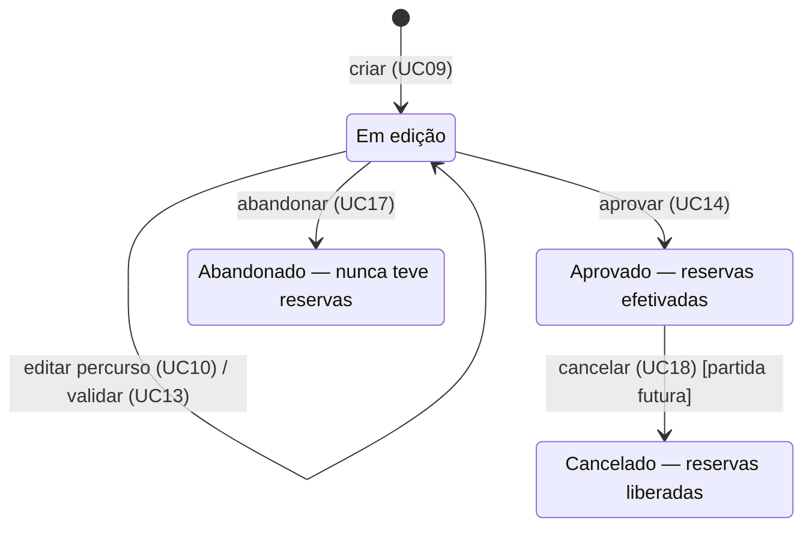

# Casos de Uso - Sistema de Gestão de Plano de Voo

## Sumário
- [Atores e escopo](#atores-e-escopo)
- [Rede aérea](#rede-aérea) — UC01 a UC04
- [Pilotos e aeronaves](#pilotos-e-aeronaves) — UC05 a UC08
- [Elaboração do plano de voo](#elaboração-do-plano-de-voo) — UC09 e UC10
- [Consulta de disponibilidade](#consulta-de-disponibilidade) — UC11 e UC12
- [Validação e aprovação](#validação-e-aprovação) — UC13 e UC14
- [Consulta, abandono e cancelamento](#consulta-abandono-e-cancelamento) — UC15 a UC18

## Atores e escopo
| Ator | Papel | Casos de uso |
| --- | --- | --- |
| Usuário | Mantém os cadastros da malha, de pilotos e de aeronaves; elabora, valida, aprova, abandona e cancela planos; consulta a disponibilidade | UC01 a UC18 |
| Relógio do sistema | Ator secundário: fornece a data e hora atuais para decidir se a partida já ocorreu | UC18 |

### Ciclo de vida do plano

Somente o plano em edição aceita alterações; aprovado, cancelado e abandonado preservam os seus dados e continuam consultáveis.

## Rede aérea

Aeroportos e aerovias só podem ser consultados e criados; não existe caso de uso de alteração ou exclusão de aerovia.

### UC01 — Consultar aeroportos

**Ator:** Usuário.

**Fluxo principal**

1. O ator solicita a lista de aeroportos ou um aeroporto pelo código.
2. O sistema retorna código, nome e quantidade de vagas de cada aeroporto.
   **Exceção:** código inexistente — o sistema informa que o aeroporto não foi encontrado.

### UC02 — Cadastrar aeroporto

**Ator:** Usuário.

**Fluxo principal**

1. O ator informa código, nome e quantidade de vagas de estacionamento.
2. O sistema verifica que o código ainda não existe.
3. O sistema registra o aeroporto com suas vagas e retorna o registro criado.
   **Exceção:** código já cadastrado — o sistema rejeita o cadastro e mantém o aeroporto existente.

**Pós-condições:** o aeroporto pode ser origem ou destino de novas aerovias e planos; qualquer vaga dele recebe qualquer aeronave.

### UC03 — Consultar aerovias

**Ator:** Usuário.

**Fluxo principal**

1. O ator solicita a lista de aerovias ou uma aerovia pelo identificador.
2. O sistema retorna identificador, aeroporto de origem, aeroporto de destino e distância em km.
   **Exceção:** identificador inexistente — o sistema informa que a aerovia não foi encontrada.

### UC04 — Cadastrar aerovia

**Ator:** Usuário.

**Pré-condições:** os aeroportos de origem e de destino estão cadastrados.

**Fluxo principal**

1. O ator informa identificador, aeroporto de origem, aeroporto de destino e distância em km.
2. O sistema verifica que o identificador ainda não existe e que os dois aeroportos existem.
3. O sistema registra a aerovia e retorna o registro criado.
   **Exceções**

- Identificador já cadastrado: o sistema rejeita o cadastro; o registro existente não é substituído.
- Aeroporto de origem ou de destino inexistente: o sistema rejeita o cadastro.
  **Pós-condições:** a aerovia fica disponível para planos e consultas de disponibilidade e não pode mais ser alterada nem excluída. O sentido inverso exige outra aerovia.

## Pilotos e aeronaves

Pilotos têm apenas identificador e nome; aeronaves carregam os dados que a validação usa: velocidade de cruzeiro, autonomia e categoria.

### UC05 — Consultar pilotos

**Ator:** Usuário.

**Fluxo principal**

1. O ator solicita a lista de pilotos ou um piloto pelo identificador.
2. O sistema retorna identificador e nome de cada piloto.
   **Exceção:** identificador inexistente — o sistema informa que o piloto não foi encontrado.

### UC06 — Cadastrar piloto

**Ator:** Usuário.

**Fluxo principal**

1. O ator informa o nome do piloto.
2. O sistema registra o piloto com um identificador único e retorna o registro criado.
   **Pós-condições:** o piloto pode ser indicado em novos planos. Não há habilitações, licenças nem jornadas a controlar.

### UC07 — Consultar aeronaves

**Ator:** Usuário.

**Fluxo principal**

1. O ator solicita a lista de aeronaves ou uma aeronave pelo prefixo.
2. O sistema retorna prefixo, categoria, velocidade de cruzeiro, autonomia e os dados próprios da categoria.
   **Exceção:** prefixo inexistente — o sistema informa que a aeronave não foi encontrada.

### UC08 — Cadastrar aeronave

**Ator:** Usuário.

**Fluxo principal**

1. O ator informa prefixo, velocidade de cruzeiro (km/h), autonomia (km) e categoria.
2. O ator informa os dados próprios da categoria:
    - particular: empresa responsável pela manutenção;
    - comercial de passageiros: companhia aérea e capacidade máxima de passageiros;
    - comercial de carga: companhia aérea e capacidade máxima de carga, em toneladas.
3. O sistema verifica que o prefixo ainda não existe.
4. O sistema registra a aeronave e retorna o registro criado.
   **Exceções**

- Prefixo já cadastrado: o sistema rejeita o cadastro.
- Categoria desconhecida ou dados da categoria ausentes: o sistema rejeita o cadastro.
  **Pós-condições:** a categoria determina as regras de operação aplicadas em UC13.

## Elaboração do plano de voo

O plano é construído em duas etapas: criação com os dados gerais (UC09) e definição progressiva do percurso (UC10). Nenhuma delas reserva recursos.

### UC09 — Criar plano de voo

**Ator:** Usuário.

**Pré-condições:** piloto, aeronave e aeroportos de origem e de destino estão cadastrados.

**Fluxo principal**

1. O ator informa piloto, aeronave, aeroporto de origem, aeroporto de destino e data e hora previstas para a partida.
2. O sistema verifica que piloto, aeronave e aeroportos existem.
3. O sistema cria o plano com identificador único, situação "em edição" e percurso vazio.
4. O sistema retorna o plano criado.
   **Exceção:** piloto, aeronave ou aeroporto inexistente — o sistema rejeita a criação.

**Pós-condições:** existe um plano em edição, sem trechos e sem reservas.

### UC10 — Definir percurso do plano

**Ator:** Usuário.

**Pré-condições:** o plano existe e está em edição.

**Fluxo principal**

1. O ator informa a sequência ordenada de trechos do plano.
2. Para cada trecho, o ator informa aerovia, altitude, horário previsto de entrada na aerovia e o que ocorre na chegada: sobrevoo ou pouso.
3. Para cada pouso, o ator informa a vaga pretendida e o tempo de permanência em minutos.
4. O sistema calcula a duração e o horário de chegada de cada trecho a partir da distância da aerovia e da velocidade de cruzeiro da aeronave.
5. O sistema grava o percurso e retorna o plano com os horários calculados.
   **Fluxos alternativos**

- Alterar trecho: o ator muda altitude, horário de entrada, pouso ou sobrevoo, vaga ou permanência de um trecho já informado.
- Reduzir ou refazer o percurso: o ator remove trechos ou substitui a sequência inteira.
  **Exceções**

- Plano aprovado, cancelado ou abandonado: o sistema rejeita a alteração.
- Aerovia inexistente, ou vaga que não pertence ao aeroporto de destino do trecho: o sistema rejeita o trecho.
  **Pós-condições:** o plano continua em edição e a vaga indicada não está reservada. O percurso pode estar incompleto; sua consistência é verificada em UC13. O sistema nunca escolhe nem propõe aerovias.

## Consulta de disponibilidade

As duas consultas mostram a ocupação no momento da requisição e não reservam nada. Só reservas de planos aprovados contam como ocupação.

### UC11 — Consultar altitudes disponíveis em uma aerovia

**Ator:** Usuário.

**Fluxo principal**

1. O ator informa a aerovia e o período desejado: data, hora de início e hora de fim.
2. O sistema determina os slots de uma hora tocados pelo período.
3. O sistema verifica, para cada altitude de 25.000 a 35.000 pés, se há reserva naquela aerovia em algum desses slots.
4. O sistema retorna as altitudes disponíveis no período.
   **Exceção:** aerovia inexistente ou período inválido — o sistema rejeita a consulta.

### UC12 — Consultar vagas disponíveis em um aeroporto

**Ator:** Usuário.

**Fluxo principal**

1. O ator informa o aeroporto e o período desejado: data, hora de início e hora de fim.
2. O sistema determina os slots de uma hora tocados pelo período.
3. O sistema verifica, para cada vaga do aeroporto, se há reserva em algum desses slots.
4. O sistema retorna as vagas disponíveis no período.
   **Exceção:** aeroporto inexistente ou período inválido — o sistema rejeita a consulta.

## Validação e aprovação

Validar apenas responde se o plano poderia ser aprovado agora; aprovar repete as verificações e efetiva todas as reservas ou nenhuma.

### UC13 — Validar plano de voo

**Ator:** Usuário.

**Pré-condições:** o plano existe e está em edição.

**Fluxo principal**

1. O ator solicita a validação do plano.
2. O sistema verifica que há pelo menos um trecho e o percurso é contínuo da origem ao destino do plano.
3. O sistema calcula duração e chegada de cada trecho e confere o encadeamento dos horários informados.
4. O sistema verifica que há pouso no destino e todo pouso tem vaga e permanência.
5. O sistema verifica que a chegada ao destino ocorre na data da partida.
6. Para cada trecho, o sistema aplica a regra de operação da categoria da aeronave à altitude e ao intervalo de uso da aerovia.
7. O sistema acumula a distância desde o último pouso e a compara com 85% da autonomia.
8. O sistema determina os slots de cada trecho e de cada permanência e verifica se a altitude e a vaga estão livres em todos eles.
9. O sistema retorna o resultado: plano válido ou a lista de problemas encontrados.
   **Resultados de falha** (em todos, o plano continua em edição)

| Falha | Exemplo |
| --- | --- |
| Percurso inconsistente | Nenhum trecho; R1 seguida de R6; última aerovia não chega ao destino do plano |
| Horários incompatíveis | Entrada no trecho seguinte diferente da chegada calculada, ou da chegada mais a permanência |
| Pouso final ausente ou incompleto | Sobrevoo no destino final; pouso sem vaga ou sem permanência |
| Voo passa da meia-noite | Chegada ao destino final no dia seguinte ao da partida |
| Restrição da aeronave | Particular a 30.000 pés; carga com trecho que termina às 06:20 |
| Autonomia insuficiente | Trechos com sobrevoo somam mais que 85% da autonomia |
| Conflito em aerovia | Altitude já reservada em um dos slots do trecho |
| Vaga indisponível | Vaga já reservada em um dos slots da permanência |

**Exceção:** plano aprovado, cancelado ou abandonado — o sistema rejeita o pedido de validação.

**Pós-condições:** a situação do plano não muda e nenhuma reserva é criada. O sistema não propõe rota alternativa.

### UC14 — Aprovar plano de voo

**Ator:** Usuário.

**Pré-condições:** o plano existe e está em edição.

**Fluxo principal**

1. O ator solicita a aprovação do plano.
2. O sistema executa todas as verificações de UC13 com a disponibilidade atual.
3. O sistema reserva, para cada trecho, a altitude na aerovia em todos os slots do trecho.
4. O sistema reserva, para cada pouso, a vaga em todos os slots da permanência, inclusive os do dia seguinte no destino final.
5. O sistema muda a situação do plano para "aprovado" e retorna o plano com suas reservas.
   **Exceções**

- Alguma verificação de UC13 falha: o sistema informa os problemas, não cria reservas e o plano continua em edição.
- Um recurso é reservado por outro plano entre a verificação e a reserva: o sistema desfaz as reservas já feitas na tentativa e o plano continua em edição.
- Plano aprovado, cancelado ou abandonado: o sistema rejeita o pedido.
  **Pós-condições (sucesso):** o plano está aprovado, não pode mais ser modificado e suas reservas passam a ocupar altitudes e vagas.

**Pós-condições (falha):** o plano está em edição e nenhuma reserva da tentativa permanece.

## Consulta, abandono e cancelamento

Planos em qualquer situação permanecem consultáveis; abandonar e cancelar são transições sem volta.

### UC15 — Consultar plano por identificador

**Ator:** Usuário.

**Fluxo principal**

1. O ator informa o identificador do plano.
2. O sistema retorna piloto, aeronave, origem, destino, partida, situação e os trechos com os horários calculados.
   **Exceção:** identificador inexistente — o sistema informa que o plano não foi encontrado.

### UC16 — Consultar planos por situação

**Ator:** Usuário.

**Fluxo principal**

1. O ator informa a situação desejada: em edição, aprovado, cancelado ou abandonado.
2. O sistema retorna os planos que estão nessa situação.
   **Exceção:** situação desconhecida — o sistema rejeita a consulta.

### UC17 — Abandonar plano em edição

**Ator:** Usuário.

**Pré-condições:** o plano existe e está em edição.

**Fluxo principal**

1. O ator solicita o abandono do plano.
2. O sistema muda a situação do plano para "abandonado".
   **Exceção:** plano aprovado, cancelado ou já abandonado — o sistema rejeita o pedido.

**Pós-condições:** o plano não pode mais ser alterado, validado ou aprovado. Não há reservas a liberar e seus dados são preservados.

### UC18 — Cancelar plano aprovado

**Atores:** Usuário; Relógio do sistema (secundário).

**Pré-condições:** o plano existe e está aprovado.

**Fluxo principal**

1. O ator solicita o cancelamento do plano.
2. O sistema verifica que o plano está aprovado.
3. O sistema compara a data e hora previstas de partida com a data e hora atuais.
4. O sistema libera todas as reservas de altitude e de vaga feitas na aprovação.
5. O sistema muda a situação do plano para "cancelado".
   **Exceções**

- Partida já ocorreu: o voo é considerado executado; o sistema rejeita o cancelamento e mantém as reservas.
- Plano em edição, abandonado ou já cancelado: o sistema rejeita o pedido.
  **Pós-condições:** o plano está cancelado, seus dados são preservados e os recursos voltam a aparecer como disponíveis em UC11 e UC12. A liberação das reservas e a mudança de situação acontecem juntas ou não acontecem.